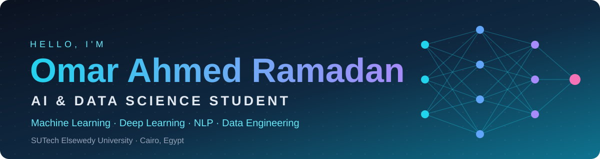

 

  

 

- 🎓 **AI & Data Science Technology** student at **SUTech (Elsewedy University of Technology)**, BTech 2024–2028, Cairo, Egypt. The program is internationally accredited by Amity University Dubai.
- 🏛️ **Ex-AI & Data Science Intern at ACUD** (Administrative Capital for Urban Development), where I built 10+ projects across machine learning, deep learning, computer vision and NLP.
- 🧠 I build **end-to-end AI products**: clean the data, train and compare models, then ship them as interactive apps people can actually use.
- 🌍 Hands-on with **Arabic NLP**, including preprocessing designed specifically for Arabic text.
- 🎨 Comfortable across the **full stack**: UI design, backend and databases.
- 🛠️ **15 projects in my first two years** covering programming, databases, networking, robotics, data science, AI and web development.
- 🎯 Focused on **Data Science, Machine Learning and AI Engineering**. Open to internships and junior roles (Egypt or remote).
- 💬 Ask me about: machine learning projects, Arabic text processing, data cleaning, dashboards and model deployment.

### AI & Data Science Intern · ACUD (Aug – Sep 2026)
Hands-on internship covering the full pipeline from data preprocessing to deployed AI apps:

| Phase | What I worked on |
|---|---|
| **Machine Learning** | Data cleaning, Linear & Logistic Regression, KNN, Decision Trees, Random Forest, ensemble methods, K-Means, Hierarchical Clustering, DBSCAN |
| **Deep Learning & Vision** | ANN, CNN, RNN, YOLO object detection (vehicle detection project) |
| **NLP & GenAI** | Arabic text analysis, RAG, building an LLM from scratch |
| **Graduation project** | **CapitalFlow AI**, a traffic prediction dashboard |

Deployed three real apps: **CapitalFlow AI**, **Arabic Reviews Sentiment Analysis** and **OCR Text Extractor**.

### 🤖 AI & Machine Learning

| | |
|---|---|
| **Frameworks** |        |
| **Supervised Learning** |         |
| **Unsupervised & Anomaly Detection** |     |
| **Deep Learning & Vision** |          |
| **NLP & GenAI** |        |
| **Classic AI** |      |
| **Data Mining & Evaluation** |         |

### 💻 Languages, Data & Web

| | |
|---|---|
| **Languages** |         |
| **Data & Visualization** |            |
| **Front-end** |         |
| **Back-end & Databases** |            |
| **Testing & DevOps** |      |
| **Tools & Systems** |        |

<table>
<tr>
<td width="50%" valign="top">

### 🚌 [SUTech Transportation](https://github.com/Ahmed-Aldmrdash/sutech-transport)
Bilingual (Arabic / English) **PWA** that digitises the SUTech university bus service: 23 routes, 27 buses, 10 user roles. Built by a 10-student team for the university's Transportation Department. [Live demo →](https://sutech-transport.vercel.app)

- Live tracking, SOS alerts and a rotating-QR digital card
- **RAG** chatbot (Gemini Flash) answering from official documents
- 133 pages, 297 unit tests, 195 E2E scenarios

     

</td>
<td width="50%" valign="top">

### 🚦 [CapitalFlow AI](https://github.com/OmarAhmedRamadan07/CapitalFlow)
End-to-end ML and deep learning dashboard predicting road traffic across Egypt's New Administrative Capital (ACUD graduation project).

- 5 models compared, **ensemble** deployed (R² up to **0.976**)
- Faster Road Advisor and Road Closure Advisor
- Trip classification: entering, exiting, inside or passing through

    

</td>
</tr>
<tr>
<td width="50%" valign="top">

### 🏙️ [NYC Airbnb Market Predictor](https://github.com/OmarAhmedRamadan07/RealEstate-Airbnb-NYC-ProjectDataMining)
Data mining project following **CRISP-DM**, deployed as a cloud-hosted SaaS tool.

- Price prediction with polynomial **Linear Regression**
- **K-Means** market tiers on a Plotly Mapbox map
- **Random Forest** Premium vs Affordable (**83%** accuracy)
- **One-Class SVM** for pricing fraud detection

   

</td>
<td width="50%" valign="top">

### 🔤 [OCR Text Extractor](https://github.com/OmarAhmedRamadan07/OCR)
Fully local handwriting and print recognition built on Microsoft's **TrOCR** transformer (ACUD).

- Otsu thresholding and automatic line segmentation
- Optional offline spell-check
- Streamlit app plus a fine-tuning notebook

   

</td>
</tr>
<tr>
<td width="50%" valign="top">

### ☁️ [Cloud-Native HR Analytics](https://github.com/OmarAhmedRamadan07/AI-Powered-HR-Analytics-System-ProjectCloud-DB)
Distributed HR analytics and attrition prediction pipeline. [Live demo →](https://cloud-db-6lqfshxx4bugvcelxkzdnx.streamlit.app/)

- Scalable **PySpark** ETL pipeline
- **Random Forest** attrition model and **K-Means** segmentation
- Interactive Streamlit and Plotly dashboard

   

</td>
<td width="50%" valign="top">

### 🌤️ [Modern Weather Dashboard](https://github.com/OmarAhmedRamadan07/ModernWeatherDashboard-ProjectWebProgramming-SUTec)
A weather app that doesn't just show numbers, it *feels* like the weather. Pure HTML, CSS and vanilla JavaScript.

- Glassmorphism UI with dark / light mode
- Video and sound that change with weather and time
- Leaflet map with click-to-forecast, plus saved cities

   

</td>
</tr>
</table>

- 💬 **Arabic Reviews Sentiment Analysis** (ACUD): classifies ~**40,000** real Arabic customer reviews as positive, neutral or negative. Custom Arabic cleaning (diacritics, letter normalization) and negation-aware stopword filtering that keeps words like «مش» and «لا». TF-IDF (unigrams + bigrams) with Logistic Regression, deployed as a Streamlit app with per-class confidence scores.
- 🕹️ **AI Maze Solver (Pacman)**: a rational agent on the UC Berkeley Pacman framework. Compares **BFS, DFS and A\*** (Manhattan heuristic): on the big maze A\* expanded 549 nodes vs 620 for BFS, and added an **MLP neural "risk radar"** that predicts danger from ghost proximity and walls.
- 📊 [NYC Real Estate Optimization](https://github.com/OmarAhmedRamadan07/RealEstate-Airbnb-NYC-ProjectDataAnalyticsAndVisualization): prescriptive rule-based engine that benchmarks 45,000+ listings against their neighborhood, with a Power BI executive dashboard and a Streamlit listing simulator.
- 🧹 [NYC Airbnb Data Cleaning](https://github.com/OmarAhmedRamadan07/RealEstate-Airbnb-NYC-ProjectDataCleansingAndMigration): IQR outlier removal, median imputation, geospatial validation, correlation heatmap.

I enjoy building the interface as much as the model behind it:

- 🌤️ **Modern Weather Dashboard**: dynamic UI, interactive maps and a backend with a database (featured above).
- 📊 **Streamlit and Plotly dashboards** for every ML project: CapitalFlow AI, Sentiment Analysis, OCR, HR Analytics, NYC Predictor and the NYC Listing Simulator.
- 📈 **Power BI** executive dashboard with geospatial mapping and slicers.
- 🖥️ **PyQt5 desktop GUI** for the Clozr file compressor, with Huffman tree and compression-ratio visualization.

- 🗜️ **Clozr File Compressor (X-Compress)**: lossless **Huffman coding** for text and binary files, with a PyQt5 GUI and a CLI, and modular architecture (Compressor, Decompressor, GUI, Utils).
- 🖥️ **CLI Dataset Profiler**: EDA in pure **Bash and awk** on Red Hat Linux: duplicate removal, missing / unique / min / max / mean, automatic numeric vs string detection, and a cleaning log.
- 📈 **Statistical Data Analysis** (Python): mean, SD, CV, frequency tables, histograms, polygons and ogives. **Curve Fitting** (MATLAB): quadratic least-squares model built from the design matrix.
- 🚗 [Car Rental System (Python)](https://github.com/OmarAhmedRamadan07/car-rental-management-system-Project-IntroductiontoComputerProgramming) and [Car Rental System (Java OOP)](https://github.com/OmarAhmedRamadan07/ProjectJavaOOP-CarRentalSystem): inheritance, polymorphism, encapsulation and role-based access.
- 🪑 [Furniture Store Database](https://github.com/OmarAhmedRamadan07/furniture-store-database-ProjectDatabase): ERD, 3NF normalization, DDL / DML and advanced SQL queries.
- 🌐 [Enterprise WAN](https://github.com/OmarAhmedRamadan07/DNS-DHCP-BusinessNetwork-ProjectNetworkBasics): DHCP, DNS, inter-site routing and email servers in Cisco Packet Tracer, with a business plan.
- 🤖 [Autonomous Obstacle-Avoiding Robot](https://github.com/OmarAhmedRamadan07/autonomous-4wd-robot-Project-Principles-of-Physics): Arduino and C++ using ultrasonic time-of-flight, a servo scan and an L298N motor driver.

- 📧 Gmail: [oa109115@gmail.com](mailto:oa109115@gmail.com)
- 🎓 University email: [omar240102684@sut.edu.eg](mailto:omar240102684@sut.edu.eg)
- 💼 LinkedIn: [linkedin.com/in/omar-ahemed](https://www.linkedin.com/in/omar-ahemed)

⭐ Thanks for stopping by. Feel free to reach out about internships, projects or collaboration.

